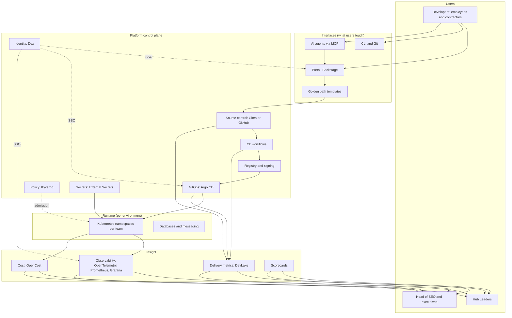

# 02 · Reference architecture

The CNCF *Platforms White Paper* defines a platform as an integrated collection of capabilities presented according to the needs of its users, and lists 13 capability domains. This lab implements each one with an open-source tool that runs on a laptop, and names the enterprise equivalent for Scenario A (Azure and GitHub).

## The picture

## Capability map

| # | CNCF capability | Lab tool | Enterprise equivalent (Scenario A) | Built in phase |
| --- | --- | --- | --- | --- |
| 1 | Web portals | Backstage | Backstage, or a commercial portal (see `03-tooling-options.md`) | 2 |
| 2 | APIs and CLIs for provisioning | Kubernetes API with Crossplane or kro; Score for the workload spec | Same, plus Azure Resource Manager through Crossplane or Terraform | 3, 10 |
| 3 | Golden path templates | Backstage Software Templates | Same, one per stack | 3, 11 |
| 4 | Build and test automation | Workflows in Gitea Actions or Argo Workflows | GitHub Actions or Azure Pipelines with reusable workflows | 3 |
| 5 | Delivery and verification | Argo CD, Argo Rollouts | Same | 3, 5 |
| 6 | Development environments | Dev containers, preview namespaces | Codespaces or Dev Box, preview environments | 3 |
| 7 | Observability | OpenTelemetry, Prometheus, Grafana, Loki | Azure Monitor, or the existing commercial APM | 6 |
| 8 | Infrastructure | kind cluster | AKS, plant edge clusters | 1 |
| 9 | Data services | CloudNativePG operator | Azure SQL, PostgreSQL Flexible Server | 10 |
| 10 | Messaging | NATS or Strimzi (Kafka) | Event Hubs, Service Bus | 10 |
| 11 | Identity and secrets | Dex, External Secrets Operator | Entra ID as upstream IdP, Key Vault | 4 |
| 12 | Security services | Kyverno, Trivy, cosign, Syft | Same, plus the corporate code-scanning product | 5 |
| 13 | Artifact storage | Gitea registry or Harbor | Azure Container Registry, GitHub Packages | 3 |

Two layers that the white paper does not list separately but the role needs:

| Layer | Lab tool | Phase |
| --- | --- | --- |
| Delivery and adoption metrics | Apache DevLake, Backstage scorecards, a survey form | 7 |
| Cost and showback | OpenCost, licence register in `finops/` | 8 |
| AI capability (agents, skills, MCP) | MCP servers registered in the catalog, an AI gateway with budgets | 9 |

## Design rules

1. **Thin platform.** Own the interfaces (portal, templates, APIs, docs). Reuse providers for everything behind them. This is the white paper's guidance on platform teams.
2. **Git is the source of truth.** Everything a developer asks for becomes a commit. Argo CD applies it. This gives the audit trail that SOX and change control need without a separate ticket.
3. **One workload spec.** A developer describes the service once (`platform/score/score.yaml`). The platform decides how that becomes Kubernetes, a database and a dashboard in each environment.
4. **Secure by default, strict only where it must be.** Policies start in audit mode, are measured, and are enforced once the golden path already satisfies them.
5. **Optional and composable.** A team can adopt the catalog without the pipeline, or the pipeline without the runtime. Mandatory items are only the security and compliance controls in `governance/directives.md`.
6. **Every capability has an owner, an SLO and a usage metric.** If nobody uses it after two quarters, it is removed.

## Environments and tenancy

| Environment | Purpose | Who can deploy | Change control |
| --- | --- | --- | --- |
| `dev` | Fast feedback | Any team member, automatically on merge | None |
| `staging` | Integration and performance | Automatic promotion after checks | Checks must pass |
| `prod` | Corporate production | Promotion by pull request, approved by someone other than the author | Segregation of duties, evidence retained |
| `plant-edge` | Tier 1 plant workloads | Promotion in agreed windows, progressive rollout | Same as prod, plus window and tested rollback |

Tenancy is a namespace per team per environment, with quotas, default-deny network policy and cost labels. The lab simulates the four environments as namespaces in one kind cluster.

## Fast path: CNOE

CNOE (Cloud Native Operational Excellence) publishes `idpbuilder`, a single binary that creates a kind cluster with Argo CD, Gitea and ingress, and reference "stacks" that add Backstage, Keycloak and Argo Workflows on top. The lab uses it in Phase 1 so that the first working platform appears in minutes, and then replaces or extends pieces one phase at a time. That order (working system first, then depth) is also the order to recommend in a real organisation.
