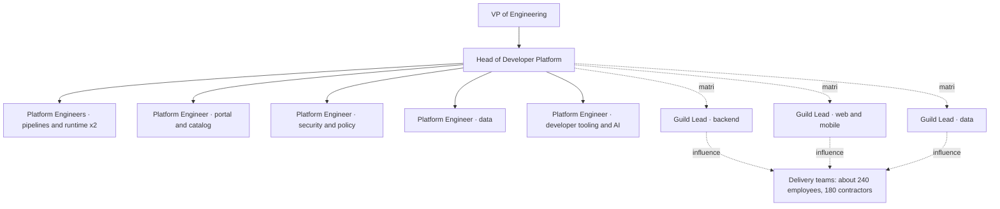

# Team and hiring

Fictional structure for Kestrel Parcel's Developer Platform Group.

## Structure

## The two roles

| | Platform Engineer | Guild Lead |
| --- | --- | --- |
| Reports to | Head of Developer Platform | Their domain director; matrix to the head |
| Mission | Build and run the golden paths and shared capabilities | Get the guild's delivery teams to adopt them, and bring their friction back |
| Success | Time to first deploy, path reliability, satisfaction of path users | Teams active on the path, scorecard pass rate, vendor gap |
| Profile | Strong engineer with a product mindset who enjoys enabling others | Respected senior engineer or architect in that area, good at persuasion |
| Team Topologies type | Platform team | Enabling role |

## Hiring order

1. **Pipelines and runtime engineers.** Nothing else can start without the first golden path.
2. **Guild Lead for the first path's stack.** Adoption needs a trusted voice inside the delivery teams.
3. **Portal and catalog, then security and policy**, once the first path has three active teams.
4. **Data, then developer tooling and AI**, as the roadmap reaches them.

Appoint Guild Leads from inside where possible; credibility with the teams matters more than platform experience.

## Role scorecard template (fill two in exercise L11)

| Field | Content |
| --- | --- |
| Role | |
| Mission in one sentence | |
| Outcomes in the first 12 months (three to five, measurable) | |
| Competencies | |
| Evidence to look for in interviews | |
| Signals of a poor fit | |

## Interview loop

| Stage | Assesses |
| --- | --- |
| Screening conversation | Motivation, product mindset |
| Technical depth | Credibility with the teams they will serve |
| Design exercise: "design the golden path for X and its adoption plan" | Scope judgement, empathy for users |
| Stakeholder conversation with a domain tech lead | Influence without authority |
| Head of Developer Platform | Values, growth, how they handle disagreement |

## Leading the matrix roles

Guild Leads do not report to the head, so authority has to be replaced with:

- An agreed share of their time, written down with their director.
- Shared goals that appear in both their director's objectives and the group's.
- A weekly rhythm where they bring problems and leave with help.
- Visible credit: adoption wins are presented by the Guild Lead and the team.
- Data they can use with their own teams (scorecards, survey results by stack).

## Rituals

| Ritual | Cadence | Who |
| --- | --- | --- |
| One-to-one | Weekly | Head with each of the nine |
| Platform planning | Every two weeks | Head, engineers |
| Guild Leads sync | Weekly | Head, Guild Leads |
| Retrospective | Monthly | Whole group |
| Demo | Monthly | Whole group plus invited teams |
| Growth conversation | Quarterly | Head with each engineer |

## Growth

Each engineer has a development plan with one platform skill, one product skill and one stack skill per year. Certification budget covers the CNCF platform engineering track.
