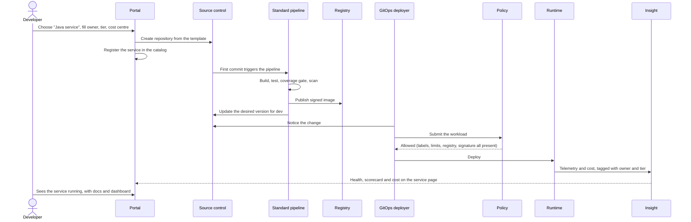

# 01 · Anatomy of an IDP

An Internal Developer Platform is not one product. It is a set of parts that a platform team assembles and presents to developers as one experience. This page names the parts and shows how a request travels through them.

## Two words that get mixed up

| Term | Meaning |
| --- | --- |
| Internal Developer **Platform** | Everything: the self-service layer, pipelines, environments, policies, runtime and metrics |
| Internal Developer **Portal** | The front door only: the website where developers find and request things. Backstage is a portal framework |

A portal with nothing behind it is a catalog. A platform with no portal still works, through Git and command-line tools, but is harder to discover.

## The parts

### 1. What developers touch

| Part | What it does | Example |
| --- | --- | --- |
| Portal | One website for everything a developer needs | Backstage |
| Software catalog | Inventory of services, APIs, owners and dependencies | Backstage Software Catalog |
| Self-service templates ("marketplace") | A menu of things to create with one form: a service, a pipeline, a database, an environment | Backstage Software Templates |
| Documentation site | Docs written next to the code and published in the portal | Backstage TechDocs |
| Search | One search across catalog and docs | Backstage Search |
| Plugins | Each tool (pipelines, clusters, cost, incidents) shown as a tab on the service's page | Backstage plugins |
| Scorecards | Automatic checks of each service against the standards | Tech Insights or a commercial portal |
| Agent access | AI agents use the same catalog and actions through MCP servers | MCP servers registered in the catalog |

Backstage describes itself as an open source framework for building developer portals, centred on a software catalog that unifies infrastructure tooling, services and documentation.

### 2. The golden paths

A golden path is a template plus a pipeline plus documentation plus support for one kind of software. It is where the parts are wired together for the developer. See `technical/04-golden-path-design.md`.

### 3. The delivery machinery

| Part | What it does | Example |
| --- | --- | --- |
| Source control | Where code and configuration live | GitHub, GitLab |
| CI (build and test) | Builds, tests, scans and packages every change | GitHub Actions, GitLab CI, Tekton |
| Artifact registry | Stores built images and packages | Container registry |
| CD (deployment) | Puts a version into an environment and promotes it | Argo CD, Flux |

Spotify built its own centralised CI/CD system, **Tingle**, in 2017 for backend, data and web services. When code is committed, it builds the project, posts feedback on the pull request and notifies the developer when deployment is complete. The lesson for any organisation is the model, not the tool: one standard pipeline that every golden path uses, so improvements reach every team at once. Most companies get this with reusable pipeline definitions in the CI product they already own.

### 4. The platform core

A widely used model lists five functions an IDP must cover behind the interface:

| Function | What it means | Example |
| --- | --- | --- |
| Application configuration management | One place and one format for how each service is configured in each environment | A workload spec such as Score, Helm values, the portal's own `app-config` for the portal itself |
| Infrastructure orchestration | Turning "I need a database" into a real, correctly configured resource | Crossplane, Terraform modules, a platform orchestrator |
| Environment management | Creating and removing environments on demand, including previews | Namespaces per team, preview environments |
| Deployment management | Promotion, rollout and rollback rules | GitOps with Argo CD, progressive rollouts |
| Role-based access control | Who may do what, driven by team membership | Single sign-on with group-based roles |

"The configuration app" that people mention is usually the first of these: the place a developer states what the service needs, without writing infrastructure code.

### 5. Guardrails

| Part | What it does | Example |
| --- | --- | --- |
| Policy as code | Rejects or reports workloads that break a rule | Kyverno, OPA |
| Secrets | Delivers credentials at runtime, never in code | External Secrets with a vault |
| Supply chain | Scans, signs and records what was built | Trivy, cosign, SBOM |

### 6. Insight

| Part | What it does | Example |
| --- | --- | --- |
| Observability | Metrics, logs, traces, dashboards, SLOs | OpenTelemetry, Prometheus, Grafana |
| Delivery metrics | Lead time, failure rate and the rest | DevLake, DX |
| Cost | Spend per team, service and environment | OpenCost, cloud billing exports |

### 7. Runtime

Where workloads run: Kubernetes clusters, a managed PaaS, serverless, and for Kestrel Parcel also hub-edge clusters. The platform hides most of this from the developer.

## How a request travels

In words:

1. The developer picks a template in the portal and answers a few questions.
2. The portal creates a repository that already contains code, pipeline, deployment configuration, docs and catalog entry.
3. The standard pipeline builds, tests, scans and publishes the result.
4. A deployer watches Git and applies what Git says should run.
5. Policy checks the workload on the way in. The template already satisfies the rules, so it passes.
6. The running service sends telemetry and is costed, both labelled with its owner.
7. The portal shows the service, its health, its scorecard and its cost.

No ticket was opened and no platform engineer was involved. That is self-service.

## Why this matters to a leader

| Design fact | Leadership consequence |
| --- | --- |
| Owner, tier and cost labels are asked once, in the template | Cost allocation and accountability come for free on the path |
| Rules are checked by policy, and the template passes them | Compliance is measured as a pass rate, and contractors meet the same bar |
| Everything is a commit | Audit evidence and change history exist without extra process |
| One standard pipeline | One improvement benefits every team; one failure affects every team, so it needs an SLO |
| The portal reads from the catalog | Catalog coverage is the first adoption number |

## What already exists in this repo

| Part | Starter file |
| --- | --- |
| Catalog entities | `technical/appendix/platform/catalog/` |
| Software template | `technical/appendix/platform/templates/java-service/template.yaml` |
| Standard pipeline example | `technical/appendix/platform/pipelines/golden-path-ci.yml` |
| Workload spec | `technical/appendix/platform/score/score.yaml` |
| Policies | `technical/appendix/platform/policies/kyverno/` |
| Identity | `technical/appendix/platform/identity/dex/config.yaml` |
| AI capabilities in the catalog | `technical/appendix/platform/catalog/ai-capabilities.yaml` |

All untested starters.
