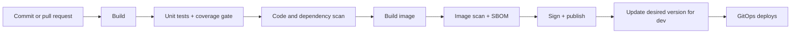

# 05 · Golden-path design

What a golden path is made of. The leadership side (choosing, launching, measuring) is in `leadership/strategy/golden-path-plan.md`.

## Contents of a golden path

| Piece | Purpose | In this repo |
| --- | --- | --- |
| Template form | Asks only what the platform cannot know: name, owner, system, tier, data classification, cost centre | `technical/platform/templates/dotnet-service/template.yaml` |
| Skeleton repository | Minimal working service, tests, container build, docs folder, agent instructions | To be written in build-plan Phase 3 |
| Standard pipeline | Build, test, quality gate, scan, package, publish | `technical/platform/pipelines/golden-path-ci.yml` |
| Deployment definition | How and where it runs in each environment | `technical/platform/score/score.yaml` |
| Catalog entry | Makes the service visible with its owner and metadata | `technical/platform/catalog/example-component.yaml` |
| Guardrails | The rules the output must pass | `technical/platform/policies/kyverno/` |
| Tutorial | Step-by-step guide a new joiner can follow | To be written with the pilot team |
| Version and changelog | So teams know what changed and can upgrade | Annotation `golden-path-version` |

## The standard pipeline

One pipeline definition, owned by the platform team, called by every service on the path. The service's own pipeline file is a few lines that say "use the standard one".

| Stage | Blocks the change when | Directive |
| --- | --- | --- |
| Unit tests and coverage | A test fails or coverage on new code is under the threshold | SEO-DIR-021 |
| Code and dependency scan | A critical finding exists | SEO-DIR-032 |
| Image scan and SBOM | A critical vulnerability exists; SBOM is always produced | SEO-DIR-032, SEO-DIR-033 |
| Sign and publish | Signing fails | SEO-DIR-031 |

Design choices that matter:

- **Central definition, local call.** Teams cannot quietly remove a gate, and the platform team can improve every pipeline with one change.
- **Extension points.** Teams add their own steps (integration tests, performance tests) without forking the standard.
- **Fast feedback.** The pipeline has a time budget. Slow pipelines are the most common developer complaint.
- **Pipeline as a product.** It has an owner, an SLO and a changelog, because a broken standard pipeline stops everyone.

Spotify's Tingle follows this model as an in-house system. In GitHub Actions the same idea is a reusable workflow; in Azure Pipelines, a template; in Tekton, shared tasks and pipelines.

## Levels of use

| Level | Team's pipeline file contains |
| --- | --- |
| Zero configuration | One call to the standard pipeline |
| Configured | The call plus parameters and extra steps |
| Building blocks | Individual shared steps composed by the team |

## Versioning and upgrades

- The template stamps each new service with the path version.
- Pipeline changes are released under a version tag; services pin a major version and receive minor updates automatically.
- Breaking changes come with an automated pull request to each affected repository where possible.
- The portal shows which services are behind, as a scorecard check.

## What "done" means for version 0.1

1. A developer creates a service and reaches a running instance in a dev environment in under an hour with no help.
2. The service is in the catalog with owner, tier and docs.
3. A failing test blocks publication.
4. The tutorial has been followed start to finish by someone outside the platform team.

## Questions a leader should ask about any golden-path design

1. What does the developer have to know that the platform could know for them?
2. What happens to the teams that cannot use it?
3. How does a service created six months ago get today's improvements?
4. Which rules does the path satisfy by default, and how is that proven?
5. Who is on call when the standard pipeline breaks?
